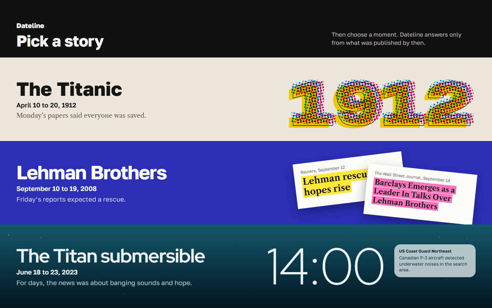
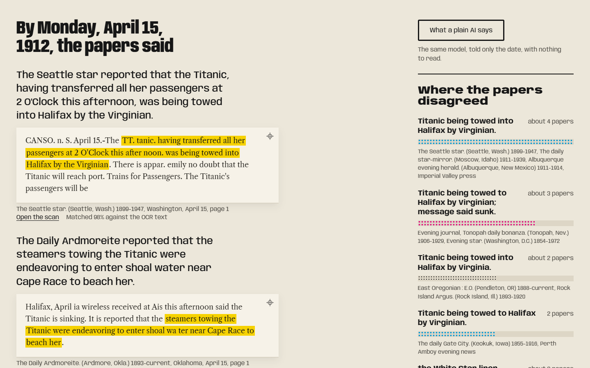
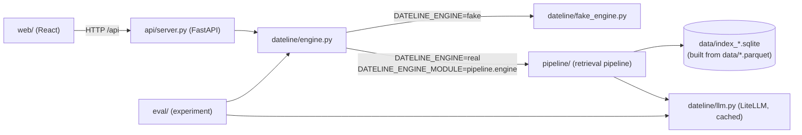
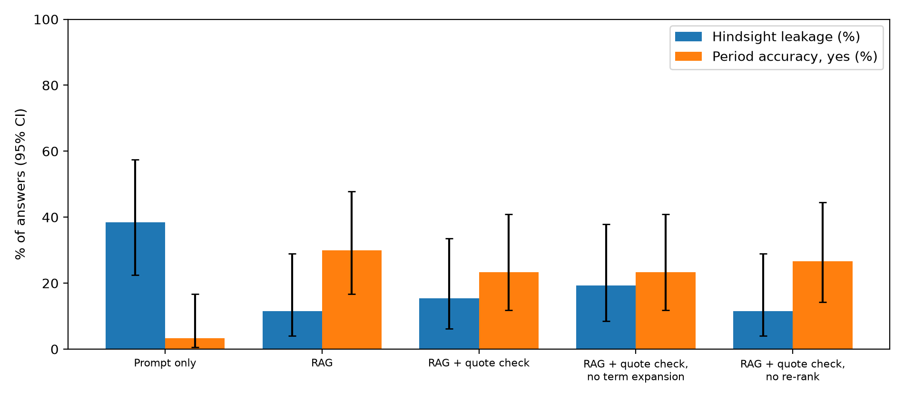

# Dateline

Dateline answers questions using only news that had been published by a moment you choose, and quotes the article behind every sentence. Ask about the Titanic on the morning of April 15, 1912 and it reports that the passengers are safe, because that is what many papers printed that day.



Large language models already know how events turned out, and instructing them to forget does not work reliably. Dateline enforces the cutoff in the system instead of the prompt:

1. **Date-locked retrieval.** Search (BM25) only sees articles dated on or before the cutoff; an LLM re-ranks the top results.
2. **Quoted answers.** Every sentence of the answer must carry a verbatim quote and the ID of the article it came from.
3. **Quote check.** Code fuzzy-matches each quote against its article and removes any sentence it cannot verify, so hindsight that slips into the answer is caught and shown as removed.
4. **Disagreement view.** Articles are grouped by the claim they make, with counts, so conflicting early reports stay visible.

The evaluation measures how much hindsight leaks through with a prompt-only baseline, with retrieval, and with retrieval plus the quote check.

Built by Ali Hussain Syed ([ali-dazai](https://github.com/ali-dazai)) as a two-person course project for BITS F471, Introduction to Large Language Models (November 2026). I proposed and scoped the project, built the retrieval pipeline, the web app and the data files, and designed and ran the evaluation.



## Demo stories

| Story | Sources | Cutoff | Look |
| --- | --- | --- | --- |
| The Titanic, April 10–20, 1912 | [American Stories](https://huggingface.co/datasets/dell-research-harvard/AmericanStories) (Chronicling America OCR), 282,013 articles | Day | 1912 four-colour newsprint |
| Lehman Brothers, September 10–19, 2008 | [Guardian Open Platform](https://open-platform.theguardian.com/), 561 items | Day | Highlighted photocopies |
| The Titan submersible, June 18–23, 2023 | Guardian Open Platform, 443 items (live-blog posts split into timestamped entries) | Minute | Phone lock screen |

## Architecture



Everything outside the engine talks to it through one function, `answer(question, cutoff, guard, event)`, defined in [`dateline/contract.py`](dateline/contract.py) and described in [docs/engine-interface.md](docs/engine-interface.md). The retrieval pipeline (`pipeline/`) implements it, and a fake engine implements the same contract with canned answers, so the web app and the evaluation run with either.

### Selecting the engine

Set in `.env`:

| Engine | Settings |
| --- | --- |
| Retrieval pipeline (`pipeline/`) | `DATELINE_ENGINE=real`, `DATELINE_ENGINE_MODULE=pipeline.engine` |
| Canned answers, no model or corpus | `DATELINE_ENGINE=fake` |

The pipeline needs one search index per story, built once from the corpus files: `.venv\Scripts\python.exe -m pipeline.index` (all stories whose corpus is present, about a minute for 1912) or `-m pipeline.index titanic-1912`. It never builds an index on its own: a missing or outdated index gives a notice naming the command. How it works, step by step, is in [docs/pipeline-design.md](docs/pipeline-design.md).

### The retrieval pipeline

1. **Search terms.** The question's own words at full weight, plus up to 8 synonyms or period spellings suggested by the model at low weight (names and numbers it adds are dropped).
2. **Date-locked search.** BM25 over a SQLite FTS5 index, restricted to articles available at the cutoff, with the BM25 statistics computed from those articles only; top 50.
3. **Re-rank.** The model picks up to 10 of the 50; the top 3 hits of a search on the question's words alone are always kept.
4. **Compose.** The model writes sentences from passages of the chosen articles, each with a verbatim quote, the article and the claim it supports.
5. **Checks.** Code removes a sentence whose quote is not in its article, whose article is not available at the cutoff, or that states a number, a name or content words its passage does not contain (OCR-tolerant, never across a negation).
6. **Groups.** A fourth call sorts the other candidates by the claims found, so the page shows how many papers printed each version.

The model's answer is cached before the checks, so the quote check on and off show the same answer with and without the removals.

## Running the demo (Windows)

After the one-time setup below, double-click **`Start Dateline demo.bat`**. It rebuilds the web app if its source changed, starts the server, and opens http://localhost:8000. Keep its window open during the demo; closing it stops the server.

Before a demo with the retrieval pipeline, after the last code change:

```powershell
.venv\Scripts\python.exe -m pipeline.index           # only if an index is missing or a corpus changed
.venv\Scripts\python.exe -m pipeline.warm            # answers every preset and default question, check on and off, and the plain answer
.venv\Scripts\python.exe -m pipeline.warm --check    # makes no model call; exit code 0 means every item answers from the cache
```

`--check` also runs with the network off. Any change to `pipeline/*.py`, the model or an index invalidates the stored answers, so run `warm` again afterwards (the model's replies stay cached, so this costs little). Start the server a minute before presenting: it loads the stored presets and the model client in the background.

## Setup

Requirements: Windows 10/11, [uv](https://docs.astral.sh/uv/), Node.js 20 or newer, an [OpenRouter API key](https://openrouter.ai/keys) (the answer and judge model is Claude Haiku 5.5, `openrouter/anthropic/claude-haiku-5.5`), and a [Guardian Open Platform key](https://open-platform.theguardian.com/access/) for rebuilding the 2008 and 2023 data.

```powershell
git clone https://github.com/ali-dazai/dateline.git
cd dateline
uv venv --python 3.12 .venv
uv pip install --python .venv\Scripts\python.exe -r requirements.txt
copy .env.example .env                                   # then add your keys
.venv\Scripts\python.exe scripts\check_setup.py          # one test call with DATELINE_MODEL
cd web; npm install; npm run build; cd ..
```

Run the setup from a normal PowerShell window. A virtual environment created from inside a sandboxed app can point at a Python that other programs cannot see.

### Data

The corpora are not in git (`data/articles.parquet` alone is about 150 MB). Rebuild them with:

| File | Rebuild with |
| --- | --- |
| `data/articles.parquet` | `scripts\download_years.ps1`, then `scripts\build_articles.py` |
| `data/articles_lehman-2008.parquet`, `data/articles_titan-2023.parquet` | `scripts\fetch_guardian.py` (needs `GUARDIAN_API_KEY`) |

The per-day and per-hour article counts the web app shows are cached in `data/counts_*.json` and tracked, so the app works without the corpora when the fake engine is selected.

### Adding a story

Nothing in the pipeline is specific to the three demo stories. A new story needs:

1. **A corpus file** in `data/`, a parquet table with one row per article:
   - required: `article_id` (unique), `paper`, `date` (`YYYY-MM-DD`), `headline`, `text`, `url`;
   - optional: `available_at` (ISO 8601 UTC, when the item could first be read; defaults to the end of `date`), `page`, `state` (shown as the place), `scan_url`.
   An article counts at a cutoff when `available_at` is at or before it.
2. **An entry in [`dateline/events.py`](dateline/events.py)** under a new id such as `"quake-1906"`: `title`, `subject` (how a plain question names the story, e.g. "the San Francisco earthquake"), `dates`, `start`, `end`, `granularity` (`day` for date cutoffs, `minute` for UTC times), `look`, `corpus` (the parquet path), `story_terms` (words always searched at low weight, e.g. the story's name) and `source`; a minute story may add `display_offset_hours` and `display_tz_label` for the time the page shows.
3. **The index:** `.venv\Scripts\python.exe -m pipeline.index quake-1906`.

The API then lists the story (`GET /api/events`) and answers for it. A page in the web app also needs an entry in `web/src/stories.ts` (title, theme, opening question and cutoff), and its preset questions go in `data/presets.json`.

## Development

```powershell
.venv\Scripts\python.exe -m pytest -q                                      # tests
.venv\Scripts\python.exe -m uvicorn api.server:app --reload --port 8000    # API, docs at /docs
cd web; npm run dev                                                        # web app on :5173, proxies /api to :8000
```

Configuration lives in `.env` (see [`.env.example`](.env.example)): the answer and judge models, the request interval, which engine to use, and the API keys.

## Repository layout

| Path | Contents |
| --- | --- |
| `api/` | FastAPI server; serves the API and the built web app |
| `pipeline/` | Retrieval pipeline engine: index, date-locked search, re-rank, compose, quote check, groups, answer cache, preset warm-up ([design](docs/pipeline-design.md)) |
| `dateline/` | Engine contract, fake engine, story definitions, LLM client, configuration |
| `eval/` | Test set loader, prompt-only baseline, judges, experiment runner, report |
| `scripts/` | Corpus builders, Guardian fetcher, test-set builder, setup check |
| `web/` | React front end: start page and one page per story (see [web/README.md](web/README.md)) |
| `tests/` | Unit and API tests |
| `data/` | Test set, questions, cached counts (corpora are not tracked) |
| `docs/` | Engine interface, pipeline design and evaluation method |

## Evaluation

The method, metrics and commands are in [docs/evaluation.md](docs/evaluation.md). In short: 15 questions about April 1912, asked at one to three cutoffs each (30 rows), are answered by the same model in three setups (prompt only, retrieval, retrieval plus quote check), plus two ablations of the retrieval pipeline. LLM judges score leakage of later facts and accuracy against period answers.

On Claude Haiku 5.5 (November 5, 2026), judged leakage over the 26 rows whose outcome the model knows was 10/26 (38%) prompt only, 3/26 (12%) with retrieval and 4/26 (15%) with retrieval plus the quote check; fully accurate answers were 1, 9 and 7 of 30. Confidence intervals, the tuning/held-out split, the ablations and the limitations are in [docs/evaluation.md](docs/evaluation.md).



## Use of AI tools

Dateline was built with heavy help from an AI coding assistant (Claude, by Anthropic). I wrote the design and the specifications, made the decisions, and ran every experiment and the demo; the assistant drafted most of the code, the documentation and the front-end design, which were then run and tested in this repository. The answer key in `data/testset.csv` was drafted from the 1912 article text with the assistant, not from model knowledge, and a period answer is accepted only if `scripts/build_testset.py` finds its supporting quotes in articles dated on or before the cutoff. The model under test and the judges (Claude Haiku 5.5, through OpenRouter) come from the same model family as the assistant, so the answer key was checked by script against the articles rather than trusted to any model.
